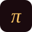
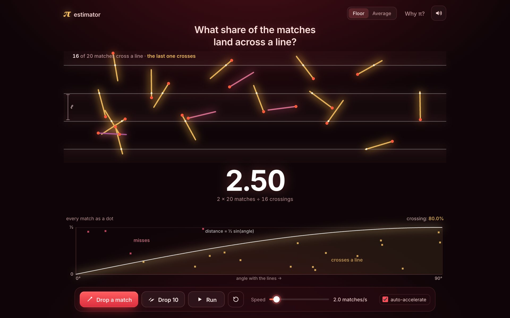
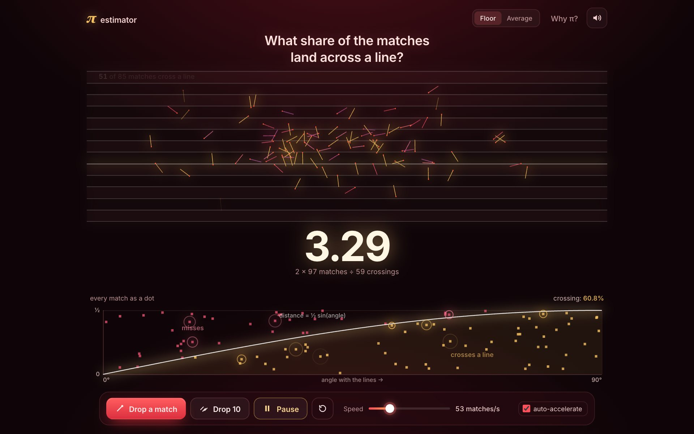
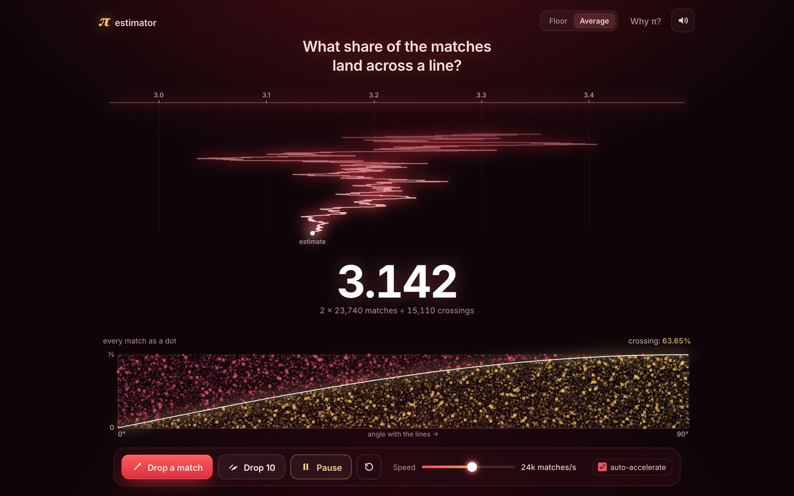
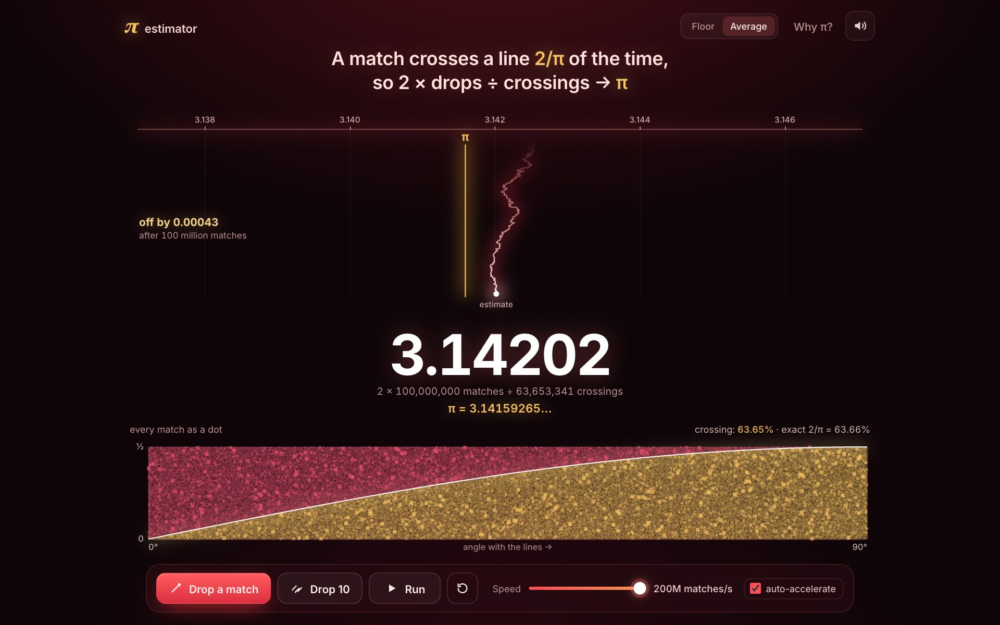
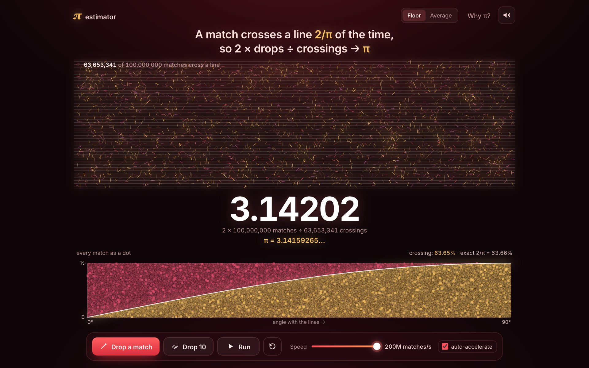
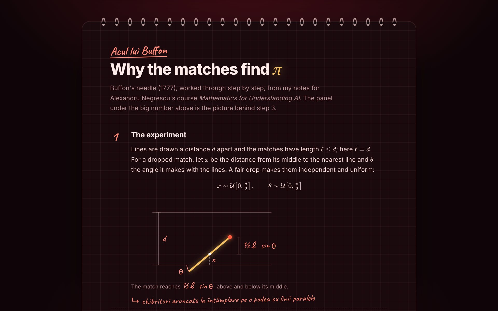
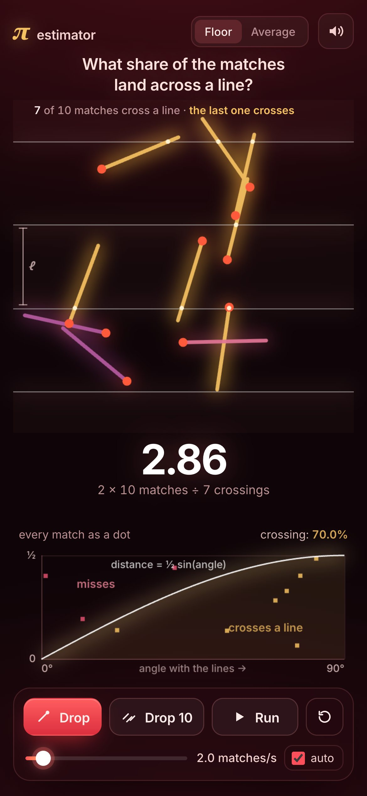

<div align="center">



# Estimating π

**Buffon's Needle, With Matches on a Lined Floor**

Drop matches on a floor ruled with lines exactly one match-length apart, and count how many land
across a line. A match crosses a line **2/π** of the time, so twice the number of drops divided by
the number of crossings closes in on **π = 3.14159…** This page runs that experiment live, up to
100 million matches, with sound, and then shows where the 2/π comes from.

[](https://developer.mozilla.org/docs/Web/JavaScript)
[](https://developer.mozilla.org/docs/Web/API/Canvas_API)
[](https://developer.mozilla.org/docs/Web/API/Web_Audio_API)
[](https://katex.org)
[](#-how-it-works)

### [🔥 Live demo →](https://claudiu1910.github.io/pi-estimator/)



</div>

## ✨ Highlights

- **Matches you can watch fall.** Each one lands at a random place and angle on the lined floor.
  The estimate is simply twice the drops divided by the crossings.
- **Every drop as a dot.** A plot of each match's angle against its distance from the nearest line.
  The curve *distance = ½ sin(angle)* splits the crossings (under it, gold) from the misses (above
  it, rose), and the share of the area under the curve is exactly 2/π.
- **Two views of the same run.** *Floor* shows the matches. *Average* draws the running estimate as
  a trace on an axis that keeps zooming in as it closes in on π.
- **From one match to 100 million.** *Run* speeds itself up from a couple of matches a second to
  tens of millions a second, stops at 100 million, and tells you how far off it ended up. π itself
  appears after 1,000,000 matches.
- **No π hidden inside.** Picking angles with `Math.random() * Math.PI` would put π into the
  experiment that is meant to measure it. Each direction comes from a random point in the unit
  circle instead, so π only appears in the final estimate.
- **The maths behind it.** A notebook below the simulation works out where 2/π comes from and
  compares your first 3,408 matches with Lazzarini's famous 1901 result. It follows my notes for
  *Mathematics for Understanding AI*, a course by Alexandru Negrescu.
- **Sound made in the browser.** A wooden knock for each landing, a bell on a D♭ major pentatonic
  scale when a match crosses a line, and a match-strike scratch when a run starts. Every sound is
  synthesized with the Web Audio API; there are no audio files.
- **Works on a phone.** The layout rearranges for small screens, and tapping the floor drops a match.

## 📸 Tour

| A run in progress | Closing in on π |
| :---: | :---: |
|  |  |
| **100 million matches** | **The floor at full speed** |
|  |  |
| **Why the matches find π** | **On your phone** |
|  |  |

## 🚀 Run it on your computer

It's a static site with no build step and nothing to install. Open `index.html` directly, or serve
the folder with any static server:

```bash
git clone https://github.com/claudiu1910/pi-estimator.git
cd pi-estimator
python3 -m http.server 8000
```

Then open **http://localhost:8000**.

## 🌍 How it is published

The live demo is hosted on [GitHub Pages](https://pages.github.com), straight from the root of the
`main` branch. There is nothing to build, so every push to `main` updates the demo within about a
minute and it always matches the code here.

To host your own copy: fork the repository, go to **Settings → Pages**, set **Source** to *Deploy
from a branch*, pick `main` and `/ (root)`, and save. The site appears at
`https://<your-username>.github.io/pi-estimator/`.

## 🎛️ Controls

| Control | What it does |
| --- | --- |
| **Drop a match** / `Space` / `N` / tap the floor | Drops one match |
| **Drop 10** / `D` | Drops ten in a quick shower |
| **Run** / `Enter` / `P` | Runs on its own. With *auto-accelerate* on, it speeds up from a couple of matches a second to tens of millions a second and stops at 100 million matches |
| Speed slider | Sets a fixed speed (turns auto-accelerate off) |
| **Floor / Average** / `V` | Switches between the floor and the running-average trace |
| Sound button / `M` | Mutes or unmutes |
| Reset / `R` | Starts over |

Milestones: the exact 2/π share shows up next to the dot plot after 100,000 matches, and π itself
shows up after 1,000,000.

## 🧮 How it works

The notebook on the page has the full derivation. In short:

1. **The experiment.** The lines are a distance d apart and the matches have length ℓ = d. For a
   dropped match, x is the distance from its middle to the nearest line, uniform on [0, d/2], and θ
   is its angle with the lines, uniform on [0, π/2].
2. **When does it cross?** The match reaches (ℓ/2) sin θ above and below its middle, so it crosses
   a line exactly when x ≤ (ℓ/2) sin θ.
3. **Probability is an area.** (θ, x) is a uniform point in a rectangle of area (π/2)(d/2). The
   crossings are the region under the curve, whose area is ℓ/2, so P(cross) = 2ℓ/(πd) = **2/π**.
   That rectangle is the dot plot under the big number.
4. **Turn it around.** The share of crossings estimates 2/π, so 2 × drops ÷ crossings estimates π.
5. **No π hidden inside.** The angle is drawn without using π, by picking a random point in the unit
   disc and taking its direction.
6. **How close it should get.** The typical error is about 2.37/√n after n matches, so about
   ±0.00024 after 100 million. Each extra correct decimal costs 100 times more matches.
7. **Lazzarini's lucky throw.** In 1901 Mario Lazzarini reported 1,808 crossings in 3,408 drops,
   with needles 5/6 as long as the line spacing. That gives (5/3)(3408/1808) = 355/113 = 3.1415929…,
   right to six decimals, when the typical error for that many drops is about ±0.05.

## 🗂️ Project structure

```text
index.html          The page: the floor, the controls and the maths notebook
styles.css          The dark red look, and the phone layout
js/
  app.js            The simulation, the canvas drawing and the controls
  audio.js          The sound engine (Web Audio synthesis, no audio files)
docs/
  logo.svg          The logo at the top of this page
  screenshots/      The pictures on this page
```

## 🛠️ How it's built

- **Plain HTML, CSS and JavaScript.** No framework and no build step; the scripts are loaded as
  ordinary `<script>` files.
- **Glow without a library.** Each canvas is drawn twice: once sharp, and once at half resolution
  with a blur behind it, which gives the soft light around the matches and the trace.
- **A dot plot that builds up.** Each dot is painted once into an offscreen canvas that fills in over
  the run, so the plot can show 100 million drops without storing each one.
- **Typesetting.** The maths is typeset with [KaTeX](https://katex.org) from cdnjs, and the fonts
  (Inter, and Caveat for the handwritten notes) come from Google Fonts.

## 📚 Credits

The maths follows my notes from *Mathematics for Understanding AI*, a course by Alexandru Negrescu.
